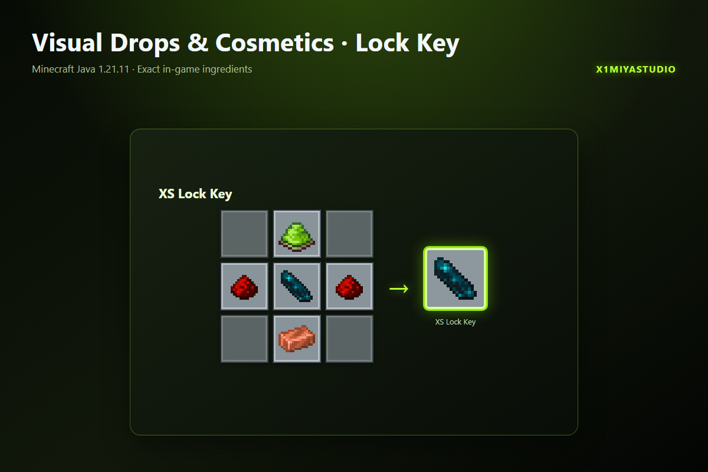

<div align="center">


[](https://www.minecraft.net/)
[](https://github.com/X1miyaStudio/Visual-Drops-and-Cosmetics)
[](https://github.com/X1miyaStudio/Visual-Drops-and-Cosmetics)
[](https://t.me/X1miyaStudio)

<p align="center">
  <b>Эстетичная замена стандартного 2D/плавающего дропа в Minecraft.</b><br/>
  Превращает выброшенные предметы в физические 3D-модели на базе Item Display с интерактивным хитбоксом и фиксацией замком XS Lock Key.
</p>

</div>

---

### ✨ Features / Особенности

* 📦 **Полное сохранение метаданных** — бережно сохраняет количество, прочность, зачарования и кастомные NBT-компоненты.
* 🪨 **Естественное положение** — плоские предметы (мечи, инструменты) реалистично ложатся на землю, а не парят в воздухе.
* 🖐 **Частичный подбор** — если инвентарь полон или подобран не весь стак, оставшаяся часть предмета остаётся лежать на месте.
* 🔒 **Защита от деспавна** — заблокированные предметы не исчезают со временем и имеют визуальную индикацию.
* ⚡ **Гравитация** — если опорный блок под предметом сломан, предмет падает ниже.
* ⏱ **Ванильный жизненный цикл** — незаблокированный дроп следует стандартному 5-минутному таймеру.

---

### 🔑 XS Lock Key / Ключ блокировки

<div align="center">



</div>

* Возьмите ключ в руку и нажмите **ПКМ** по лежащему предмету, чтобы заблокировать или разблокировать его.
* Игроки без прав оператора могут получить ключ через команду:
  ```mcfunction
  /trigger x1di.lock_key
  ```

---

### 🕹️ Compatibility & Installation / Совместимость и установка

* ✅ **Minecraft 1.20.5 – 26.3+** — единый мультиверсионный `.zip` файл благодаря нативной системе **Overlays** (`overlay_1_20_5`, `overlay_1_21_2`, `overlay_1_21_5`).
* ✅ **Без модов** — абсолютно чистый ванильный датапак.
* ✅ **Одиночная игра и мультиплеер** — работает на любом сервере (Vanilla, Fabric, Forge, NeoForge, Paper, Purpur).

#### Установка:
1. Поместите архив датапака в папку `<world>/datapacks/`.
2. Выполните `/reload` в игре.

---

<div align="center">

Minecraft Java Edition **1.20.5 – 26.3+** · Vanilla datapack · Namespace `x1miya_itemdrop`  
© 2026 **[X1miyaStudio](https://github.com/X1miyaStudio)**

[](https://modrinth.com/organization/x1miyastudio)
[](https://t.me/X1miyaStudio)
[](https://discord.gg/pwk6X8ecNJ)

</div>
