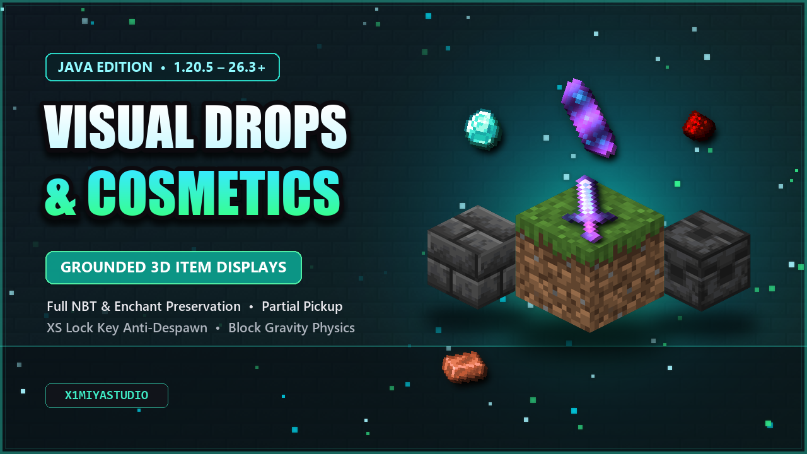
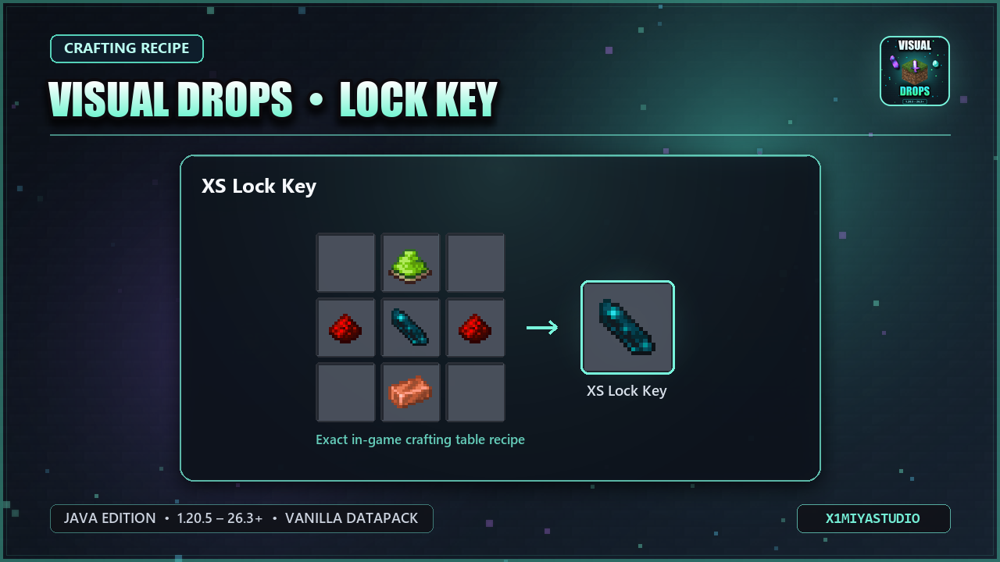

<div align="center">


<p align="center">
  
  <a href="README_RU.md">
    
  </a>
</p>

[](https://www.minecraft.net/)
[](https://modrinth.com/datapack/visual-drops-and-cosmetics)
[](https://www.curseforge.com/minecraft/data-packs/visual-drops-cosmetics)
[](https://github.com/X1miyaStudio/Visual-Drops-and-Cosmetics)
[](https://github.com/X1miyaStudio/Visual-Drops-and-Cosmetics)
[](https://t.me/X1miyaStudio)

<p align="center"></p>

<p align="center">
  <b>A clean replacement for floating vanilla 2D item drops in Minecraft.</b><br/>
  Turns dropped items into grounded 3D Item Display entities with interactive hitboxes and XS Lock Key protection.
</p>

</div>

---

### ✨ Features

* 📦 **Full Metadata Preservation** — keeps item count, durability damage, enchantments, and custom NBT/item components intact.
* 🪨 **Natural Ground Pose** — flat items (such as swords and tools) lie cleanly on the ground instead of spinning in mid-air.
* 🖐 **Partial Stack Pickup** — right-click to pick up; if your inventory is nearly full, the remaining stack stays on the ground.
* 🔒 **Despawn Protection** — locked drops never despawn and display a clear visual indicator.
* ⚡ **Gravity Support** — if the supporting block underneath is broken, the item drops down naturally.
* ⏱ **Vanilla Lifetime** — unlocked items follow the standard 5-minute despawn timer.

---

### 🔑 XS Lock Key

<div align="center">



</div>

* Hold the **XS Lock Key** and **Right-Click** any dropped item to lock or unlock it.
* Non-OP players can also obtain a key via:
  ```mcfunction
  /trigger x1di.lock_key
  ```

---

### 🕹️ Compatibility & Installation

* ✅ **Minecraft 1.20.5 – 26.3+** — single multi-version `.zip` powered by native **Overlays** (`overlay_1_20_5`, `overlay_1_21_2`, `overlay_1_21_5`).
* ✅ **Zero mods required** — pure vanilla datapack.
* ✅ **Singleplayer & Multiplayer** — works on Vanilla, Fabric, Forge, NeoForge, Paper, and Purpur servers.

#### Installation
1. Download the build matching your language ([Modrinth (EN + RU)](https://modrinth.com/datapack/visual-drops-and-cosmetics) — `Visual_Drops_and_Cosmetics_v2_EN.zip` / `Visual_Drops_and_Cosmetics_v2_RU.zip`, or [CurseForge](https://www.curseforge.com/minecraft/data-packs/visual-drops-cosmetics)) and place the archive in `<world>/datapacks/`.
2. Run `/reload` in-game.

---

<div align="center">

Minecraft Java Edition **1.20.5 – 26.3+** · Vanilla datapack · Namespace `x1miya_itemdrop` · All Rights Reserved  
© 2026 **[X1miyaStudio](https://github.com/X1miyaStudio)**

[](https://modrinth.com/datapack/visual-drops-and-cosmetics)
[](https://www.curseforge.com/minecraft/data-packs/visual-drops-cosmetics)
[](https://t.me/X1miyaStudio)
[](https://discord.gg/pwk6X8ecNJ)

</div>
