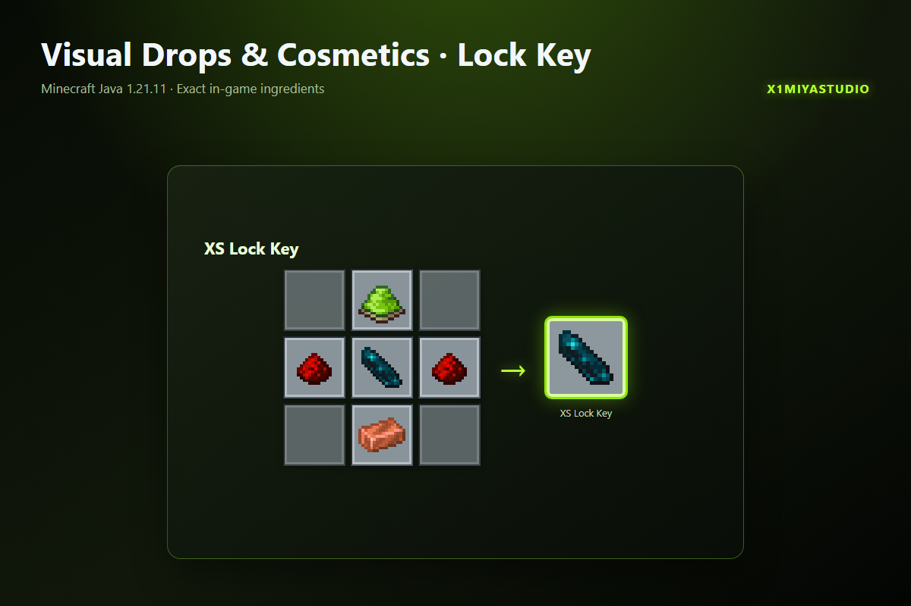

# Визуальные предметы и косметика

Датапак заменяет лежащие ванильные предметы аккуратными трёхмерными моделями с зонами взаимодействия. Предметы подбираются правой кнопкой мыши, а ценные находки можно заблокировать XS Ключом блокировки.

## Возможности

- Сохраняет количество, повреждение, зачарования и пользовательские компоненты предмета.
- Плоские предметы лежат на земле, а не стоят вертикально.
- При частичном подборе остаток стака остаётся видимым.
- Заблокированные предметы не исчезают и получают визуальную индикацию.
- Если опорный блок сломан, предмет снова падает.
- Время жизни в пять минут соответствует ванильным предметам.

## XS Ключ блокировки

Держи ключ и нажми ПКМ по предмету на земле, чтобы заблокировать или разблокировать его. Игрок без прав оператора может получить ключ командой `/trigger x1di.lock_key`.

## Установка

Помести ZIP в `<мир>/datapacks/`, затем выполни `/reload`.

Minecraft Java Edition **1.21.11** · Ванильный датапак · Namespace `x1miya_itemdrop` · All Rights Reserved · X1miyaStudio
